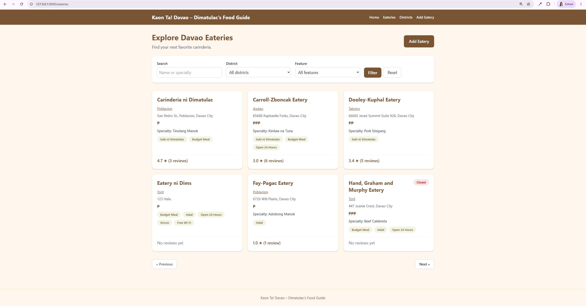
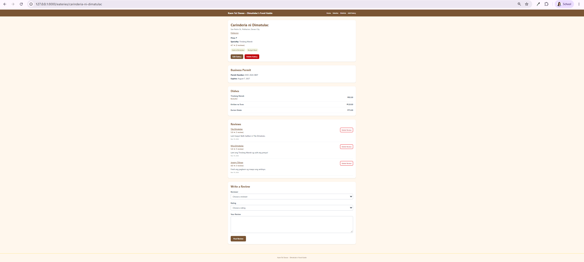
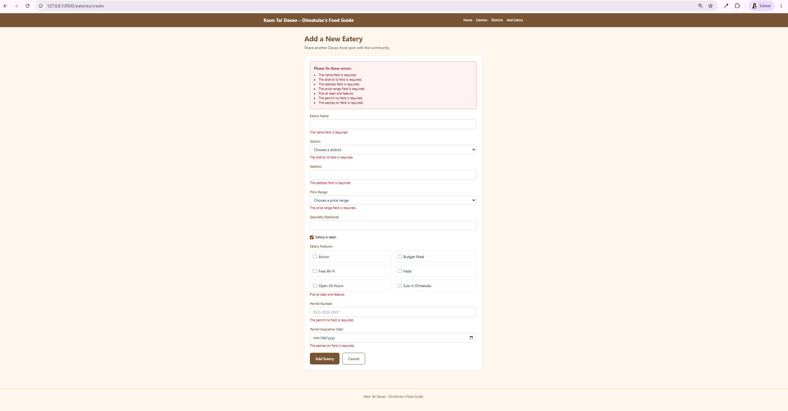

# Kaon Ta! Davao – Dimatulac's Food Guide

**Student:** Mica Julianna P. Dimatulac  
**Course:** CS Elective 2 – Full-Stack Development  
**Project:** Prefinal Milestone Project  
**Framework:** Laravel  
**Database:** SQLite  
**Frontend:** Blade, Tailwind CSS, and Vite

## Project Overview

Kaon Ta! Davao is a simple food guide for carinderias
and eateries in Davao City.

Visitors can browse eateries by district, search by name
or specialty, filter by features, and read reviews.

The project also allows users to add, edit, and delete
eateries, manage business permit information, and
submit or delete reviews.

No login is required. Reviewers are selected from
the seeded users.

## Features

- Homepage with eatery, district, and review counts
- Top three rated eateries
- Eatery listing with search and filters
- Six eateries per page with pagination
- Eatery details, dishes, and permits
- Feature badges and district links
- Add, edit, and delete eateries
- Submit and delete reviews
- Closed eateries cannot receive reviews
- Reviewer profile pages
- Form Request validation
- Responsive Tailwind CSS design

## Requirements

- PHP and Composer
- Node.js and npm
- SQLite support for PHP
- Git

## Installation

Clone the repository:

```bash
git clone https://github.com/micajuliannadimatulac/PrefinalProject-Dimatulac-KaonTaDavao.git
cd PrefinalProject-Dimatulac-KaonTaDavao
```

Install PHP dependencies:

```bash
composer install
```

Create the environment file:

```bash
cp .env.example .env
```

Generate the application key:

```bash
php artisan key:generate
```

Create the SQLite database:

```bash
touch database/database.sqlite
```

Check that `.env` contains:

```env
DB_CONNECTION=sqlite
```

Create tables and seed sample data:

```bash
php artisan migrate:fresh --seed
```

Install frontend dependencies:

```bash
npm install
```

Build frontend assets:

```bash
npm run build
```

Start Laravel:

```bash
php artisan serve
```

Open the local address shown in the terminal.

For development, you may use `npm run dev`.

## Personalized Data

### Districts

1. Poblacion
2. Talomo
3. Agdao
4. Buhangin
5. Toril
6. Bunawan

### Eatery Features

1. Suki ni Dimatulac
2. Budget Meal
3. Halal
4. Open 24 Hours
5. Aircon
6. Free Wi-Fi

### Seeded Users

| Name | Email | Password |
|---|---|---|
| Mica Dimatulac | dimatulac@kaonta.test | kaonta2026 |
| Tita Dimatulac | tita.dimatulac@kaonta.test | kaonta2026 |

These passwords are stored as hashes.

### Personalized Eatery

| Field | Value |
|---|---|
| Name | Carinderia ni Dimatulac |
| Slug | carinderia-ni-dimatulac |
| District | Poblacion |
| Address | San Pedro St., Poblacion, Davao City |
| Price Range | budget |
| Specialty | Tinolang Manok |
| Status | Open |
| Features | Suki ni Dimatulac, Budget Meal |
| Permit | DVO-2026-0807 |
| Permit Expiration | August 7, 2027 |

### Dishes

| Dish | Price | Bestseller |
|---|---:|---|
| Tinolang Manok | ₱85.00 | Yes |
| Kinilaw na Tuna | ₱120.00 | No |
| Durian Shake | ₱75.00 | No |

### Required Review

Reviewer: Tita Dimatulac

Rating: 5 stars

Review: Lami kaayo! Balik-balikan ni Tita Dimatulac.

## Database Relationships

| Models | Relationship | Why It Fits |
|---|---|---|
| District → Eatery | hasMany | One district can contain many eateries. |
| Eatery → District | belongsTo | Each eatery belongs to one district. |
| Eatery → Dish | hasMany | An eatery can offer several dishes. |
| Dish → Eatery | belongsTo | Each dish belongs to one eatery. |
| Eatery → Review | hasMany | An eatery can receive many reviews. |
| Review → Eatery | belongsTo | Each review refers to one eatery. |
| User → Review | hasMany | A reviewer can write several reviews. |
| Review → User | belongsTo | Each review is written by one user. |
| Eatery → Permit | hasOne | Each eatery has one business permit. |
| Permit → Eatery | belongsTo | A permit belongs to one eatery. |
| Eatery → Feature | belongsToMany | An eatery can have several features. |
| Feature → Eatery | belongsToMany | The same feature can apply to many eateries. |
| District → Review | hasManyThrough | A district can access reviews through its eateries. |

The many-to-many relationship uses the
`eatery_feature` pivot table.

## Seeded Record Counts

| Record | Expected Count |
|---|---:|
| Districts | 6 |
| Features | 6 |
| Users | 12 |
| Eateries | 15 |
| Closed Eateries | 3 |
| Permits | 15 |

## Routes

The following is a summary of the project routes.
The actual output of
`php artisan route:list --except-vendor`
must be inserted below before submission.

| Method | URI | Name |
|---|---|---|
| GET | / | home |
| GET | eateries | eateries.index |
| GET | eateries/create | eateries.create |
| POST | eateries | eateries.store |
| GET | eateries/{eatery} | eateries.show |
| GET | eateries/{eatery}/edit | eateries.edit |
| PUT/PATCH | eateries/{eatery} | eateries.update |
| DELETE | eateries/{eatery} | eateries.destroy |
| POST | eateries/{eatery}/reviews | eateries.reviews.store |
| DELETE | reviews/{review} | reviews.destroy |
| GET | districts | districts.index |
| GET | districts/{district} | districts.show |
| GET | reviewers/{user} | reviewers.show |

### Actual Route List Output

```text
  GET|HEAD        / ................................................................................................................. home › HomeController
  GET|HEAD        districts .................................................................................... districts.index › DistrictController@index
  GET|HEAD        districts/{district} ........................................................................... districts.show › DistrictController@show
  GET|HEAD        eateries ........................................................................................ eateries.index › EateryController@index
  POST            eateries ........................................................................................ eateries.store › EateryController@store
  GET|HEAD        eateries/create ............................................................................... eateries.create › EateryController@create
  GET|HEAD        eateries/{eatery} ................................................................................. eateries.show › EateryController@show
  PUT|PATCH       eateries/{eatery} ............................................................................. eateries.update › EateryController@update
  DELETE          eateries/{eatery} ........................................................................... eateries.destroy › EateryController@destroy
  GET|HEAD        eateries/{eatery}/edit ............................................................................ eateries.edit › EateryController@edit
  POST            eateries/{eatery}/reviews ............................................................... eateries.reviews.store › ReviewController@store
  GET|HEAD        reviewers/{user} ............................................................................... reviewers.show › ReviewerController@show
  DELETE          reviews/{review} ............................................................................. reviews.destroy › ReviewController@destroy
```

## Screenshots

### Eatery Listing



### Eatery Details and Reviews



### Form Validation



## Testing

The project should be tested with:

```bash
php artisan migrate:fresh --seed
php artisan route:list --except-vendor
npm run build
php artisan test
```

Verify that all required pages, CRUD operations,
review restrictions, and validation messages work.

## Author

Mica Julianna P. Dimatulac
```
